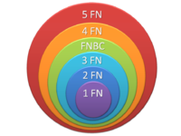

## INTRODUCCIÓN

¿Crees que tu base de datos ya podría construirse directamente sobre el SGBD relacional que hayas elegido? La respuesta podría ser afirmativa, pero si queremos que nuestra base de datos funcione con plena fiabilidad, es necesario antes llevar a cabo un proceso de normalización de las tablas que la componen. Así pues, una vez que se ha obtenido el Esquema Relacional del sistema, este debe ser analizado para comprobar que no presenta pérdida de información e inconsistencias. Es la Teoría de la Normalización la que nos permite identificar esos casos y nos muestra la forma de convertir esas tablas a una forma más deseable.

Veamos un ejemplo: en la figura siguiente se muestra una tabla denominada ESCRIBE que almacena datos sobre autores de libros y sobre los propios libros, con una clave primaria formada por: Autor y Cod_libro.

| AUTOR        | NACIONALIDAD      | COD_LIBRO | TITULO             | EDITORIAL   | AÑO  |
|--------------|------------------|----------|--------------------|-------------|------|
| DATE, C.     | NORTE AMERICANA  | 98987    | DATABASES          | ADDISON-W   | 1990 |
| DATE, C.     | NORTE AMERICANA  | 97777    | SQL STANDARD       | ADDISON-W   | 1986 |
| DATE, C.     | NORTE AMERICANA  | 98988    | A GUIDE TO INGRES  | ADDISON-W   | 1988 |
| CODD, E.     | NORTE AMERICANA  | 7980     | RELATIONAL MOD.    | ADDISON-W   | 1990 |
| GARDARIN     | FRANCESA         | 12345    | BASES DE DATOS     | PARANINFO   | 1986 |
| GARDARIN     | FRANCESA         | 67890    | COMPARACION BD     | EYROLLES    | 1984 |
| VALDURIEZ    | FRANCESA         | 67890    | COMPARACION BD     | EYROLLES    | 1984 |
| KIM, W.      | NORTE AMERICANA  | 11223    | 0-0 DATABASES      | ACM PRESS   | 1989 |
| LOCHOVSKY    | CANADIENSE       | 11223    | 0-0 DATABASES      | ACM PRESS   | 1989 |

Si observamos con atención esta tabla, vemos que presenta varios problemas:

Gran cantidad de **redundancia**, ya que la nacionalidad del autor se repite por cada ocurrencia del mismo, y algo análogo sucede, cuando un libro tiene más de un autor, con la editorial y el año de publicación.

**Anomalías de modificación**, ya que, inadvertidamente podemos, por ejemplo, cambiar el nombre de la editorial en una tupla sin modificarlo en el resto de las que corresponden al mismo libro, lo que da lugar a incoherencias.

**Anomalías de inserción**, ya que si se quisiera incluir información sobre algún autor del que no hubiera ningún libro en la base de datos, no sería posible, al formar el atributo `cod_libro` parte de la clave primaria de la tabla, ni tampoco podríamos introducir obras anónimas (la regla de integridad de entidad no permite nulos en ningún atributo que forme parte de una clave primaria). Además, la inserción de un libro que tuviera dos autores obligaría a incluir dos tuplas en la base de datos.

**Anomalías de borrado**, ya que si quisiéramos dar de baja un libro, también se perderían datos sobre sus autores (si estos no habían escrito nada más que un libro) y, viceversa, si borramos un autor desaparecerían de nuestra base de datos los libros escritos por él (a no ser que tuviera el libro más de un autor).

Vemos, por tanto, que la actualización (alta, baja o modificación) de un solo libro o de un solo autor nos puede obligar a actualizar más de una tupla, dejándose la integridad en manos del usuario; además de la falta de eficiencia asociada a estas múltiples actualizaciones.

Esta tabla presenta todos estos problemas, y alguno más, debido a que atenta contra un principio básico en todo diseño: *“hechos distintos se deben almacenar en objetos distintos”*, en este caso, en tablas distintas, con lo que se habrían evitado redundancias y, por tanto, anomalías de actualización.

Si se hubiera seguido la metodología adecuada, realizando un diseño conceptual en el modelo E/R, seguido de una cuidadosa transformación al modelo relacional, se evitarían estos problemas y se obtendría un esquema relacional exento de errores. Sin embargo, ante las posibles dudas respecto a si un determinado esquema relacional es correcto, será preferible aplicar a dicho esquema un método formal de análisis que determine lo que pueda estar equivocado en el mismo y nos permita deducir otro que nos asegure el cumplimiento de ciertos requisitos. Ese método formal es la teoría de la normalización.

## FORMAS NORMALES DE CODD

La **teoría de la normalización** trata de evitar las redundancias y las anomalías de actualización, obteniendo tablas más estructuradas que no presenten los problemas que comentábamos anteriormente. Así, en lugar de la tabla del ejemplo anterior, se podría haber diseñado el siguiente esquema relacional:

<strong>LIBRO</strong> (Cod_libro, título, editorial, año)

<strong>AUTOR</strong> (Nombre, nacionalidad)

<strong>ESCRIBE</strong> (Cod_libro*, Nombre*)

Uno de los conceptos fundamentales en la normalización es el de **dependencia funcional**. Una dependencia funcional es una relación entre atributos de una misma tabla. Veamos:

Si x e y son atributos de la tabla T, se dice que **y es funcionalmente dependiente de x** (se denota por: x→ y) si cada valor de x tiene asociado un sólo valor de y. Dicho de otra forma, para un determinado valor de x, siempre se dará el mismo y único valor de y.

x e y pueden constar de uno o varios atributos.

A x se le denomina **determinante**, ya que x determina el valor de y.

Se dice que el atributo y es **completamente dependiente** de x si depende funcionalmente de x y no depende de ningún subconjunto de x.

Por ejemplo, podemos decir que el código de un libro determina el título del mismo:

**cod_libro → título**

Ejemplo:

EMPLEADO (NIF, Nombre, Dirección, Fecha-Nac)

En la tabla Empleado, los atributos nombre, dirección y fecha de nacimiento dependen funcionalmente del atributo NIF, porque dado un valor específico de NIF existe sólo un valor correspondiente para cada uno. Esto se representa:

NIF → Nombre

NIF → Dirección

NIF → Fecha-Nac

De forma reducida se puede indicar:

NIF → Nombre, Dirección, Fecha-Nac

Sin embargo, dada una dirección no ocurre que sólo haya un empleado con esa dirección, puede que más de un empleado viva en la misma casa, así pues NIF no depende de dirección:

<s>Dirección → NIF</s>

La dependencia funcional es una noción semántica. Si hay o no dependencias funcionales entre atributos no lo determina una serie abstracta de reglas, sino los modelos mentales del usuario y las reglas de negocio de la organización o empresa para la que se desarrolla el sistema de información.

En el proceso de normalización se debe ir comprobando que cada tabla cumple una serie de reglas que se basan en la clave primaria y las dependencias funcionales. Cada regla que se cumple aumenta el grado de normalización. Si una regla no se cumple, la tabla se debe descomponer en varias tablas que sí la cumplan (la tabla original se transforma).

Al ser las dependencias funcionales restricciones que recogen la semántica de nuestro mundo real, deben estar reflejadas en el esquema de nuestra base de datos. En consecuencia, la transformación del esquema origen debe llevarse a cabo sin pérdida de estas dependencias o, lo que es lo mismo, el conjunto de dependencias funcionales de partida debe ser equivalente al conjunto de dependencias funcionales de las tablas resultantes después de las transformaciones.

La normalización se lleva a cabo en una serie de pasos. Cada paso corresponde a una forma normal que tiene unas propiedades. Conforme se va avanzando en la normalización, las tablas tienen un formato más estricto (más fuerte) y, por lo tanto, son menos vulnerables a las anomalías de actualización.

!!! note "Nota importante"
    El modelo relacional sólo requiere un conjunto de tablas en primera forma normal. Las restantes formas normales son opcionales. Sin embargo, para evitar las anomalías de actualización, es recomendable llegar al menos a la tercera forma normal.

{ .center }

Otra ventaja de la normalización de base de datos es el consumo de espacio. Una base de datos normalizada ocupa menos espacio en disco que una no normalizada. Hay menos repetición de datos, lo que tiene como consecuencia un mucho menor uso de espacio en disco.

### PRIMERA FORMA NORMAL

Una tabla está en primera forma normal, si y sólo si, todos los campos de la misma contienen valores atómicos, es decir, no hay atributos multivaluados o repetitivos. Si se ve la tabla gráficamente, estará en 1FN si tiene un sólo valor en la intersección de cada fila con cada columna.

Si una tabla no está en 1FN, hay que eliminar de ella los campos multivaluados. Una solución consiste en ponerlos en una tabla aparte, eliminándose de la tabla base. La clave principal de la nueva tabla estará compuesta por la clave principal de la tabla base (actuando también como clave ajena) y alguno o algunos de los atributos de la nueva tabla.

Ejemplo:

`LIBRO (``Código``, Título, Autor)`

| CÓDIGO    | TÍTULO          | AUTOR                         |
|-----------|-----------------|-------------------------------|
| 010101010 | DATA MODEL      | TSICHIRITZIS LOCHOVSKY     |
| 090909090 | A GUIDE TO DB2  | DATE                          |
| 010203040 | BASES DE DATOS  | GARDARIN VALDURIEZ         |

**NO ESTÁ EN 1FN HAY CAMPOS MULTIVALUADOS**{ .center }

**Solución:**

`LIBRO (``Código``, Título)`

| CÓDIGO    | TÍTULO          |
|-----------|-----------------|
| 010101010 | DATA MODEL      |
| 090909090 | A GUIDE TO DB2  |
| 010203040 | BASES DE DATOS  |

`AUTOR (``Código_lib*, Autor``)`

| CÓDIGO_LIB | NOMBRE_AUT   |
|------------|--------------|
| 010101010  | TSICHIRITZIS |
| 010101010  | LOCHOVSKY    |
| 090909090  | DATE         |
| 010203040  | GARDARIN     |
| 010203040  | VALDURIEZ    |

### SEGUNDA FORMA NORMAL

Una tabla está en segunda forma normal si, y sólo si, **está en 1FN y, además, cada atributo que no está en la clave primaria es completamente dependiente de la clave primaria.**

Es decir, cada atributo que no está en la clave primaria depende de toda la clave primaria y no de ningún subconjunto de ella. Se pretende garantizar una correcta elección de claves y eliminar redundancias.

**La 2FN se aplica a las tablas que tienen claves primarias compuestas por dos o más atributos**. Si una tabla está en 1FN y su clave primaria tiene un sólo atributo, entonces también está en 2FN. Las tablas que no están en 2FN pueden sufrir anomalías de actualización.

Para pasar una tabla en 1FN a 2FN se eliminan los atributos que no dependen funcionalmente de forma completa de la clave principal y se ponen en una nueva tabla con una copia de su determinante (los atributos de la clave primaria de los que dependen). La clave principal de la nueva tabla estará compuesta por el determinante, que será clave ajena en la tabla original.

Ejemplo:

`PUBLICA (Artículo, Revista, Número, Página, Editorial)`

| ARTICULO         | REVISTA          | NUMERO | PAGINA | EDITORIAL |
|------------------|------------------|--------|--------|-----------|
| Arritmias        | Ciencia Moderna  | 4      | 10     | Planeta   |
| Colesterol       | Ciencia Moderna  | 4      | 14     | Planeta   |
| Arritmias        | Vivir en salud   | 6      | 3      | Salvat    |
| Listas de espera | Ciencia Moderna  | 5      | 11     | Planeta   |

En la tabla anterior refleja en qué número de qué revista se publica un artículo, en qué página comienza y cuál es la editorial.

Tenemos las siguientes dependencias:

Artículo, Revista, Número → Página
Revista → Editorial

La clave primaria está compuesta por (Artículo, Revista, Número). Por tanto, el esquema no está en 2FN al venir la Editorial determinada sólo por la Revista.

Tiene además redundancias como repetir la Editorial por cada Artículo que se publica en una Revista.

**Solución:**

`REVISTA_ED (``Revista,``Editorial)`

| REVISTA            | EDITORIAL |
|--------------------|-----------|
| Vivir en salud     | Salvat    |
| Ciencia Moderna    | Planeta   |

`PUBLICA (``Artículo, Revista*, Número,` `Página)`

| ARTICULO         | REVISTA          | NUMERO | PAGINA |
|------------------|------------------|--------|--------|
| Arritmias        | Ciencia Moderna  | 4      | 10     |
| Colesterol       | Ciencia Moderna  | 4      | 14     |
| Arritmias        | Vivir en salud   | 6      | 3      |
| Listas de espera | Ciencia Moderna  | 5      | 11     |

### TERCERA FORMA NORMAL

Una tabla está en tercera forma normal, si y sólo si, **está en 2FN y además, cada atributo que no está en la clave primaria no depende funcionalmente de forma transitiva de la clave primaria**. La dependencia x → z es transitiva si existen las dependencias x → y , y → z, siendo x, y, z atributos o conjuntos de atributos de una misma tabla.

Aunque las tablas en 2FN tienen menos redundancias que las tablas en 1FN, todavía pueden sufrir anomalías frente a las actualizaciones.

Para pasar una tabla de 2FN a 3FN hay que eliminar las dependencias transitivas: se eliminan los atributos que dependen transitivamente de la clave principal y se ponen en una nueva tabla con una copia de su determinante (el atributo o atributos no clave de los que dependen). La clave principal de la nueva tabla estará compuesta por el determinante, que será clave ajena en la tabla original.

Ejemplo:

`SOCIO (``DNI``, Ciudad, País)`

| DNI      | CIUDAD     | PAÍS    |
|----------|------------|---------|
| 22334778 | Almería    | ESPAÑA  |
| 23099555 | Glasgow    | ESCOCIA |
| 22333111 | Almería    | ESPAÑA  |
| 77888999 | Edimburgo  | ESCOCIA |
| 11222333 | Glasgow    | ESCOCIA |

Presenta las siguientes dependencias funcionales:

DNI → Ciudad
Ciudad → País
DNI → País (dependencia transitiva de la clave primaria)

Dicha tabla no se encuentra en 3FN, ya que País no es conocido por la clave primaria sino que es conocido por la ciudad que no es la PK.

__Solución:__

`CIUDAD_P (``Ciudad``, País)`

| CIUDAD    | PAÍS    |
|-----------|---------|
| Almería   | ESPAÑA  |
| Glasgow   | ESCOCIA |
| Edimburgo | ESCOCIA |

`SOCIO (``DNI``, Ciudad*)`

| DNI      | CIUDAD    |
|----------|-----------|
| 22334778 | Almería   |
| 23099555 | Glasgow   |
| 22333111 | Almería   |
| 77888999 | Edimburgo |
| 11222333 | Glasgow   |

Otro Ejemplo:

`EMPLEADOS(`DNI`, Cod_Dpto, Nombre_Dpto)`

| DNI      | Cod_Dpto | Nombre_Dpto   |
|----------|----------|---------------|
| 22334778 | C01      | Contabilidad  |
| 23099555 | M05      | Marketing     |
| 22333111 | I02      | Investigación |
| 77888999 | C01      | Contabilidad  |
| 11222333 | M05      | Marketing     |

Presenta las siguientes dependencias funcionales:

DNI → Cod_Dpto
Cod_Dpto → Nombre_Dpto
DNI → Nombre_Dpto (dependencia transitiva de la clave primaria)

Dicha tabla no se encuentra en 3FN, ya que Nombre_Dpto es un atributo no es conocido por la PK sino que es conocido por Cod_Dpto que no es PK.

**Solución:**

`DEPARTAMENTOS (``Cod_Dpto,`` Nombre_Dpto)`

| Cod_Dpto | Nombre_Dpto   |
|----------|---------------|
| C01      | Contabilidad  |
| M05      | Marketing     |
| I02      | Investigación |

`EMPLEADOS (``DNI,`` Cod_Dpto*)`

| DNI      | Cod_Dpto |
|----------|----------|
| 22334778 | C01      |
| 23099555 | M05      |
| 22333111 | I02      |
| 77888999 | C01      |
| 11222333 | M05      |

Y otro ejemplo más:

`COCHES(``Matrícula,`` Modelo, Marca, Color)`

| Matrícula | Modelo  | Marca   | Color   |
|-----------|---------|---------|---------|
| 1234BCC   | Ibiza   | Seat    | Azul    |
| 4321CFR   | Focus   | Ford    | Blanco  |
| 2314BRF   | Laguna  | Renault | Rojo    |
| 5122DCC   | Ibiza   | Seat    | Gris    |
| 7763CGT   | Avensis | Toyota  | Gris    |

Presenta entre otras, las siguientes dependencias funcionales:

Matrícula → Modelo
Modelo → Marca
Matrícula → Marca (dependencia transitiva de la clave primaria)

Dicha tabla no se encuentra en 3FN, ya que Marca es un atributo que se conoce por Modelo que no esta en la PK y entonces depende transitivamente de la PK.

**Solución:**

`MODELOS(``Modelo,` `Marca)`

| Modelo  | Marca   |
|---------|---------|
| Ibiza   | Seat    |
| Focus   | Ford    |
| Laguna  | Renault |
| Avensis | Toyota  |

`COCHES(``Matrícula,` `Modelo*, Color)`

| Matrícula | Modelo  | Color  |
|-----------|---------|--------|
| 1234BCC   | Ibiza   | Azul   |
| 4321CFR   | Focus   | Blanco |
| 2314BRF   | Laguna  | Rojo   |
| 5122DCC   | Ibiza   | Gris   |
| 7763CGT   | Avensis | Gris   |
