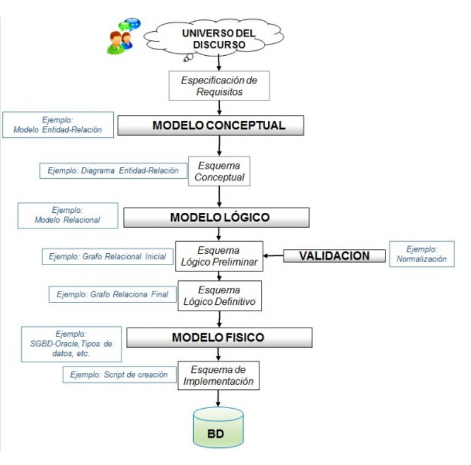

# TEMA 4: Lenguaje de Definición de Datos (DDL).Lenguaje de Control de Datos (DCL)

## RESULTADOS DE APRENDIZAJE

**RA2:** Crea bases de datos definiendo su estructura y las características de sus elementos según el modelo relacional.

## CRITERIOS DE EVALUACIÓN

* **RA2.a.** Se ha analizado el formato de almacenamiento de la información
* **RA2.b.** Se han creado las tablas y las relaciones entre ellas
* **RA2.c.** Se han seleccionado los tipos de datos adecuados
* **RA2.d.** Se han definido los campos clave en las tablas
* **RA2.e.** Se han implantado las restricciones reflejadas en el diseño lógico
* **RA2.f.** Se han creado vistas
* **RA2.g.** Se han creado los usuarios y se les han asignado privilegios
* **RA2.h.** Se han utilizado asistentes, herramientas gráficas y los lenguajes de definición y control de datos

**NÚMERO DE SESIONES:** 12 

## INTRODUCCIÓN

{.center}

El modelo físico es la traducción del modelo lógico en un esquema interpretable por el SGBD, para ello utilizaremos un Lenguaje de Definición de Datos DDL.

Un Sistema de Gestión de Bases de Datos Relacionales (SGBDRs) es un programa que nos permite crear,actualizar y administrar una base de datos relacional. La mayoría de los sistemas de gestión de bases de datos relacionales utilizan SQL para acceder a la base de datos.

Hay que tener en cuenta que pueden existir diferencias en la sintaxis SQL utilizada por los distintos SGBDRs.
Los SGBDRs más usados actualmente son:

- [SQLite](https://www.sqlite.org/)
- [MySQL](https://www.mysql.com)
- [MariaDB](https://www.mariadb.org)
- [PostgreSQL](https://www.postgresql.org)
- [OracleDB](https://www.oracle.com)
- [SQL Server](https://www.microsoft.com/es-es/sql-server)

