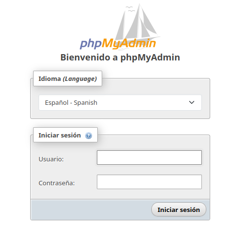
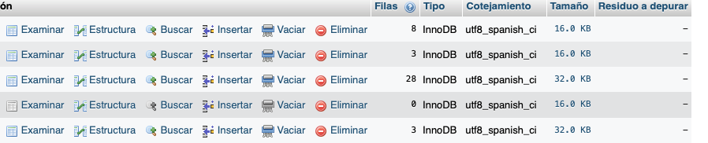
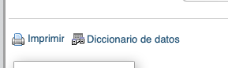

Con XAMPP disponemos de un interfaz muy utilizada basada en páginas web llamada PhpMyAdmin, que a través de un servidor web, por ejemplo Apache, permite administrar las bases de datos de un servidor desde cualquier equipo de la red.

Accedemos a través de nuestro navegador con la dirección: localhost/phpmyadmin

{.center}

- Pestaña de base de datos: Nos permite revisar los privilegios de cada base de datos, así como crear una nueva base de datos. 

- Pestaña SQL: Nos permite lanzar consultas SQL.

- Pestaña Estado Actual: Nos facilita información estadística del servidor.

- Pestaña Privilegios: Permite mantener los permisos de los usuarios.

- Pestaña Variables: Contiene información de las variables del servidor.

- Pestaña Juegos de caracteres: Muestra información sobre las codificaciones de caracteres soportadas.

- Pestaña Exportar: Nos permite exportar el contenido de las bases de datos.

- Pestaña Importar: Nos permite importar a nuestra base de datos sentencias SQL que modifiquen el estado de la misma, como por ejemplo insertando registros.

- Pestaña Motores: Nos da acceso al estado de cada motor independiente de MySQL.

Si en el panel de la izquierda seleccionamos una base de datos, por ejemplo mysql, obtenemos la lista de sus tablas, donde podemos ver el espacio real que ocupa una tabla y el número de registros aproximado.

Desde los botones que figuran a continuación de cada tabla vamos a poder ver o editar los registros, ver o modificar el diseño de la tabla, buscar en el contenido de los registros, insertar nuevos registros, vaciar la tabla o eliminar la tabla.

{.center}

En la parte inferior que no aparece en la imagen anterior, existe un enlace que nos prepara para impresión el diccionario completo de la base de datos.

{.center}

Si en el panel de la izquierda seleccionamos una tabla, podremos ver también el contenido de sus registros.

Podemos ver también que nos aparecen nuevas pestañas en la parte superior que nos permite por ejemplo editar la **estructura** de la tabla.

Donde veremos la definición de los campos y podremos modificar el campo o eliminarlo, pero también permite indicar restricciones como que posee valores únicos o que forma parte de la clave principal. También podemos cambiar a la **vista de relaciones** donde podremos crear la claves ajenas.

!!! question "Ejercicio"
    Crea una base de datos llamada BIBLIOTECA que contenga dos tablas AUTORES y LIBROS.
    AUTORES

    | Campo | Tipo de dato | Restricciones |
    |---|---|---|
    | id | INTEGER | PK, AUTOINCREMENT |
    | nombre | VARCHAR(100) | NOT NULL |
    | apellidos | VARCHAR(150) | |
    | nacionalidad | VARCHAR(100) | |
    | fecha_nacimiento | DATE | |

    LIBROS

    | Campo | Tipo de dato | Restricciones |
    |---|---|---|
    | id | INTEGER | PK, AUTOINCREMENT |
    | titulo | VARCHAR(200) | NOT NULL, UNIQUE |
    | editorial | VARCHAR(150) | |
    | autor_id | INTEGER | FK → AUTORES(id) |